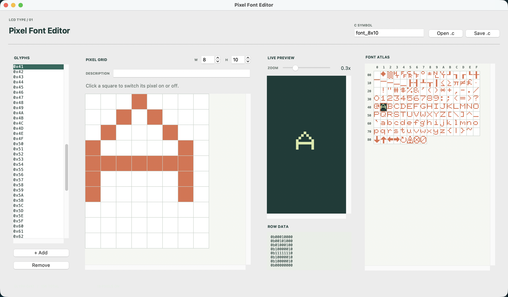
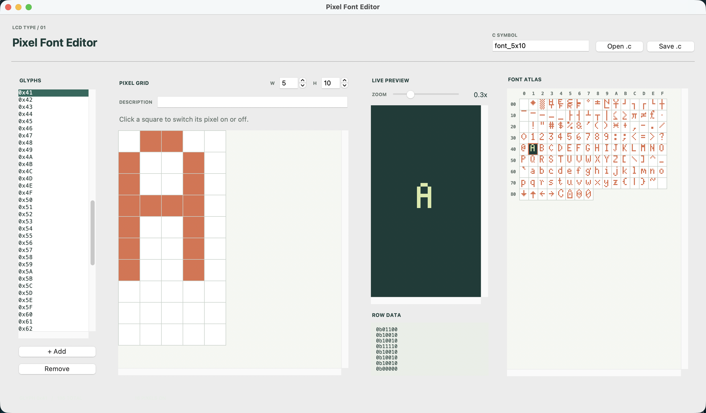

# Pixel Font Editor

Pixel Font Editor is a small desktop app for drawing monochrome bitmap fonts for LCD displays. Edit each glyph on a pixel grid, see it in a live preview, and save the finished font as a C `font_t` initializer.  

I wrote this editor to support another project I am working on with a RaspberryPi Pico connected to an SPI LCD.  It was getting tedious trying to update font files in the text editor, so I made this little tool.  I was kind of suprised that there are no existing tools that do exactly this one simple thing, so I decided to post it in case it might be helpful for someone else.

## Screenshots

| 8x10 font | 5x10 font |
|:--:|:--:|
|  |  |

## Using the editor

Start the application by double clicking the packaged executable for your platform (Windows or Mac).  That's it, no installation or support files needed.  

The editor opens with an 8x10 grid, a blank glyph, and a sample diamond. Click or drag across grid cells to turn pixels on or off. Choose a glyph from the list or the font atlas; the atlas is arranged in 16 columns and uses hexadecimal indices. Add, or remove glyphs with the controls below the list. The selected glyph's description can be edited beside its index.  This description is only for convinence when editing and will be stored as a comment in the file when exporting/saving.

Set the width and height to resize every glyph. Pixels that still fit are preserved. The live preview has an adjustable zoom, and the row-data panel shows the selected glyph as binary values. Both the preview and font atlas update as you edit.

Use **Open .c** to load a font in the editor's supported `font_t` initializer format. The bundled [5x10](sample_files/font_5x10.c) and [8x10](sample_files/font_8x10.c) fonts are ready to open. Text before the initializer, such as comments and `#include` directives, is retained when you save. Set the C symbol name at the top of the window, then choose **Save .c** to export the font.

## Requirements

- Python 3.10 or newer
- Tkinter, included with most Python installations

The app has no third-party runtime dependencies.

## How the font data works

Each glyph is stored as one integer bitmask per row. The leftmost pixel is the most-significant bit. When exported, rows are written as zero-padded binary literals, with a `// 0xNN` comment before each glyph; descriptions follow the hexadecimal index. The initializer records `.width`, while the number of rows in each glyph determines its height. The importer checks that glyph indices are sequential and rejects unsupported or malformed initializers rather than replacing the font currently open in the editor.

The model and C serializer are kept independent of the Tkinter interface. This lets the unit tests exercise pixel mapping, resizing, C formatting, and import/export round trips without opening a GUI.

## Contributing
If this tool is almost what you need but not quite, consider adding the feature that you need.  I suspect that people might want additional options for importing or exporting.  That should be pretty trivial to add, so either create and issue or submit a PR.  The only guideline is keeping things as streamlined as possible. 

## Tests and builds

Start the app from the project directory:

```sh
python3 main.py
```

Run the test suite from the project directory:

```sh
python3 -m unittest discover -s tests -t .
```

The tests cover glyph bit order and resizing, plus C serialization, parsing, header preservation, and malformed input. In VS Code, the same command is available as **Run Unit Tests** under **Tasks: Run Task**.

To build a desktop app, install PyInstaller in your development environment:

```sh
python3 -m pip install pyinstaller
```

Then run the build task for your platform from **Tasks: Run Task**. The macOS task creates a windowed build with the ICNS icon and bundled assets. The Windows task creates a single-file windowed executable with the ICO icon. The equivalent commands are:

```sh
# macOS
python3 -m PyInstaller --noconfirm --clean --windowed --name PixelFontEditor --icon assets/pixel_font_editor.icns --add-data "assets:assets" main.py

# Windows
py -m PyInstaller --noconfirm --clean --onefile --windowed --name PixelFontEditor --icon assets/pixel_font_editor.ico --add-data "assets;assets" main.py
```

Build on the platform you intend to distribute for; PyInstaller does not cross-compile between macOS and Windows. To regenerate the window and app icons, run `python3 tools/generate_icons.py`.